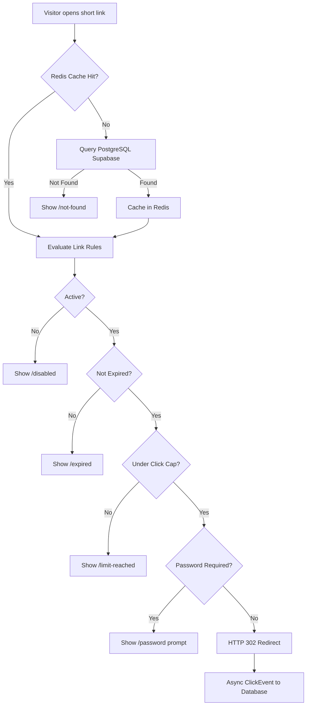

# LinkPulse
Governed URL shortener and live analytics platform built for reliable, safe link management.


## Table of Contents
- [LinkPulse](#linkpulse)
  - [Table of Contents](#table-of-contents)
  - [Overview](#overview)
  - [The Problem and Our Approach](#the-problem-and-our-approach)
  - [Key Features](#key-features)
  - [How It Works](#how-it-works)
  - [Tech Stack](#tech-stack)
  - [Getting Started](#getting-started)
  - [Environment Variables](#environment-variables)
  - [Scripts](#scripts)
  - [Project Structure](#project-structure)
  - [API Overview](#api-overview)
  - [Documentation](#documentation)
  - [Roadmap](#roadmap)
  - [Screenshots](#screenshots)
  - [Team](#team)
  - [Contributing](#contributing)
  - [License](#license)

## user credentials
user id- tejasupreti2964@gmail.com
Password-12345678
## super admin
Email -admin@linkpulse.test
Pass-Demo@1234


## Overview
Basic URL shorteners only map a code to a URL without rules or governance.
LinkPulse combines link creation, pre-publish validation, rule evaluation, and live analytics into one workflow.
Every redirect enforces active status, expiry, click caps, and password protection.
Click data is logged asynchronously after redirection so visitor response times remain fast.
The platform gives marketing and operations teams actionable insights without losing historical data.

## The Problem and Our Approach
| Problem                                      | How LinkPulse handles it                                                                            |
| -------------------------------------------- | --------------------------------------------------------------------------------------------------- |
| Basic shorteners lack rule governance        | Enforces active status, expiration date, atomic click caps, and passwords.                          |
| Scattered links without organization         | Groups links into campaigns and reusable tags with aggregated reporting.                            |
| Slow redirects caused by synchronous logging | Logs visits asynchronously via background worker after sending HTTP 302.                            |
| Malicious or dead links published by mistake | Checks destination domain and alias availability before publishing; provides instant admin disable. |
| Expired or disabled links lose click records | Retains full click history forever; marks bot visits instead of dropping data.                      |

## Key Features
- Core: Role-based access (Visitor, User, Admin), unique code and alias generator, 302 redirect engine, async click logging, live dashboard.
- Rules and Safety: Expiry dates, atomic click limits, password protection, creation wizard validation, domain blocklist, rate limiting.
- Organization and Productivity: Campaign management, tags, QR code generation with scan tracking, CSV bulk import with error reports.
- Planned Special Features: Redirect Trace debugger, device targeting, A/B split links, destination link health check, plain-English insights.

Note: Features are currently being built. Current development status is tracked in [docs/TEAM_TASKS.md](docs/TEAM_TASKS.md).

## How It Works


## Tech Stack
| Layer                   | Technology                                          |
| ----------------------- | --------------------------------------------------- |
| Framework               | Next.js (App Router, TypeScript)                    |
| UI and Styling          | Tailwind CSS, shadcn/ui, Recharts                   |
| Database and ORM        | PostgreSQL on Supabase, Prisma ORM                  |
| Authentication          | Auth.js (Credentials with bcrypt, Google OAuth)     |
| Cache and Rate Limiting | Upstash Redis                                       |
| Utilities               | isbot, ua-parser-js, nanoid, qrcode, Papaparse, Zod |
| Hosting                 | Vercel                                              |

## Getting Started
Prerequisites: Node.js 20+ and npm. For complete step-by-step setup, see [docs/SETUP.md](docs/SETUP.md).

```bash
git clone https://github.com/tejas0629/LinkPulse-URL-Shortener-Analytics-Platform-CodeXplorer-.git
npm install
cp .env.example .env
npm run dev
```

Note: The database schema in prisma/schema.prisma is currently a draft that Tejas must approve and commit before migrations. Run unit tests with `npm test`.

## Environment Variables
Configured in `.env` (template in `.env.example`):
| Variable                   | Purpose                                                   |
| -------------------------- | --------------------------------------------------------- |
| `DATABASE_URL`             | Supabase PostgreSQL pooled connection string for runtime   |
| `DIRECT_URL`               | Supabase PostgreSQL direct connection string for migrations|
| `AUTH_SECRET`              | Secret key for Auth.js session encryption                 |
| `AUTH_URL`                 | Application root URL for authentication redirects         |
| `AUTH_GOOGLE_ID`           | Google OAuth client ID                                    |
| `AUTH_GOOGLE_SECRET`       | Google OAuth client secret                                |
| `UPSTASH_REDIS_REST_URL`   | Upstash Redis REST endpoint for caching and rate limiting |
| `UPSTASH_REDIS_REST_TOKEN` | Upstash Redis REST token                                  |
| `NEXT_PUBLIC_APP_URL`      | Public application URL used for link and QR generation    |

## Scripts
| Script  | Command         | Purpose                                        |
| ------- | --------------- | ---------------------------------------------- |
| `dev`   | `npm run dev`   | Runs local dev server on http://localhost:3000 |
| `build` | `npm run build` | Builds production bundle                       |
| `start` | `npm run start` | Starts production server                       |
| `lint`  | `npm run lint`  | Runs ESLint                                    |
| `test`  | `npm test`      | Runs unit test suite via Vitest                |

## Project Structure
```text
linkpulse/
|-- app/                    # Next.js App Router pages and route handlers
|-- components/             # Reusable UI, wizard, and chart components
|-- docs/                   # Full documentation (PRD, API, architecture, database, setup)
|-- lib/                    # Core business logic, rules, validation, and database client
|-- prisma/                 # Database schema (draft) and seed scripts
\-- public/                 # Static assets
```

## API Overview
All endpoints return standard `{ data: ... }` or `{ error: ... }` formats. Detailed contracts are in [docs/API.md](docs/API.md).
| Group              | Path                              | Purpose                                              |
| ------------------ | --------------------------------- | ---------------------------------------------------- |
| Public Redirect    | `GET /[code]`                     | Redirects visitor or displays status page            |
| Authentication     | `/api/auth/*`                     | Registration, login, and session status              |
| Links              | `/api/links/*`                    | Link CRUD, alias checks, and rule configuration      |
| Analytics          | `/api/analytics/*`                | Aggregated summaries, timeseries, and breakdowns     |
| Campaigns and Tags | `/api/campaigns/*`, `/api/tags/*` | Grouping links and campaign metrics                  |
| Bulk Import        | `/api/import/*`                   | CSV preview validation and batch commit              |
| QR Codes           | `GET /api/qr/[id]`                | Generates downloadable PNG QR codes                  |
| Admin Controls     | `/api/admin/*`                    | User management, instant link disable, and blocklist |

## Documentation
| Document                                     | Description                                              |
| -------------------------------------------- | -------------------------------------------------------- |
| [docs/PRD.md](docs/PRD.md)                   | Product requirements, user stories, and feature tiers    |
| [docs/API.md](docs/API.md)                   | Complete endpoint schemas, request/response samples      |
| [docs/ARCHITECTURE.md](docs/ARCHITECTURE.md) | Architecture flowcharts and folder ownership             |
| [docs/DATABASE.md](docs/DATABASE.md)         | Database models, enums, indexes, and schema change rules |
| [docs/SETUP.md](docs/SETUP.md)               | 20-minute local environment setup and Vercel deployment  |
| [docs/TEAM_TASKS.md](docs/TEAM_TASKS.md)     | Team task allocation, priorities, and checkpoints        |

## Roadmap
From [docs/PRD.md](docs/PRD.md) future roadmap:
- Custom domain support
- Advanced device and geo targeting
- Public developer API
- Link-in-bio landing pages
- Team workspaces and shared folders
- Automated abuse detection and email alerts
- Exportable analytics reports (CSV and PDF)

## Screenshots
Screenshots will be added after the UI is built.

## Team
| Name      | Role                | Responsibility                                                                     |
| --------- | ------------------- | ---------------------------------------------------------------------------------- |
| Tejas     | Team Lead           | Repo setup, DB schema, redirect engine, async click logging, deployment            |
| Chirag    | Backend Developer   | Link creation backend, rules, rate limiting, analytics APIs                        |
| Milan     | Fullstack Developer | Auth and RBAC, campaigns and tags, CSV import, admin APIs, QR                      |
| Megha     | Frontend Developer  | Base layout, auth pages, link wizard, links list and details, visitor status pages |
| Samriddhi | Frontend Developer  | Analytics dashboard, charts, campaigns UI, QR and CSV UI, admin panel              |

## Contributing
We welcome contributions through our feature-branch workflow.
Please read [CONTRIBUTING.md](CONTRIBUTING.md) for branch naming, PR conventions, and code standards.
Always pull the latest `dev` before starting new feature work.

## License
This project is licensed under the MIT License. See [LICENSE](LICENSE) for the full license text.

