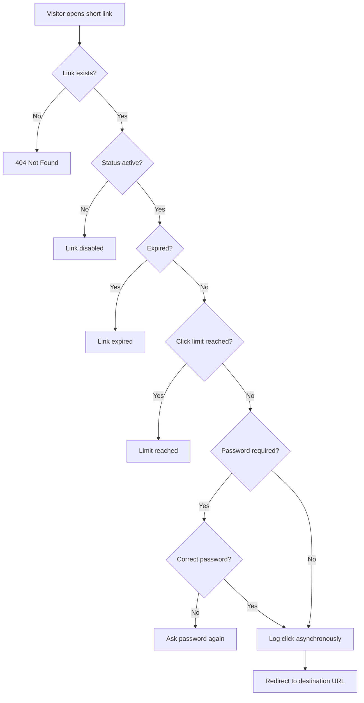

# 🔗 LinkPulse: URL Shortener & Analytics Platform

## 📌 Table of Contents

1. Problem Statement
2. Our Solution
3. Goals & Scope
4. User Roles
5. Features
6. How It Works (Complete Flow)
7. Redirect Engine Logic
8. Click Tracking & Analytics
9. Data Model (High Level)
10. Architecture Approach
11. Tech Stack
12. Project Phases
13. Demo Plan
14. Future Roadmap
15. Team
---

## 🧩 Problem Statement

Most basic URL shorteners only do one thing: map a short code to a long URL. But real marketing and operations teams need **links, analytics, and governance to work together**.

A single link may:

- belong to a **campaign**
- **expire** next month
- redirect **mobile users** to a different destination
- need to be **disabled quickly** if it turns out to be malicious

On top of that, click data must be recorded **without slowing down redirects**, and the dashboard must turn raw data into **insights people can act on**.

**The challenge:** build a platform that manages the *full link lifecycle*: creation, redirection, tracking, analytics, and expiry or takedown.

---

## 💡 Our Solution

**LinkPulse** is a URL shortener that goes beyond "paste a URL, get a short URL".

The **Link** is the central hub of the system:

| Component | Role |
|---|---|
| **Link** | Core record: destination, short code, status, rules |
| **Campaigns & Tags** | Organize and group links |
| **Redirect Rules** | Control who can access a link and when (expiry, click cap, password, status) |
| **Click Events** | Capture every visit (time, device, browser, referrer, location) |
| **Dashboard** | Turns click and link data into live, actionable reports |

Everything is **driven by real data**. No hardcoded values in redirects, rules, or reports.

---

## 🎯 Goals & Scope

- **Reliable redirection:** unique short codes; redirect only when the link is active, unexpired, and within its click limit
- **Fast redirects:** click logging happens asynchronously so users are never slowed down
- **Rules that actually work:** expiry, click caps, password protection, and active/disabled status control real redirect behavior
- **Catch problems early:** duplicate aliases and invalid URLs are flagged *before* publishing
- **Safety & governance:** unsafe domains can be blocked and abusive links disabled by admins instantly
- **Full traceability:** expired or disabled links keep their analytics
- **Live analytics:** the dashboard aggregates click and link data by period and campaign

---

## 👥 User Roles

### 🌐 Visitor (Anonymous)
- Opens short links
- Enters passwords for protected links
- No management access

### 👤 User
- Creates and manages **their own** links, campaigns, tags, and QR codes
- Views analytics for **their own links only**

### 🛡️ Admin
- Full access to all links, users, and settings
- Disables abusive links and manages the domain blocklist
- Views **platform-wide** analytics

---

## ✨ Features

### Core (Must Have)
- [ ] Authentication & role-based access (Admin / User / Visitor)
- [ ] Short link creation with auto-generated unique codes
- [ ] Custom aliases
- [ ] Redirect engine
- [ ] Click tracking (time, device, browser, referrer)
- [ ] Basic link and click analytics
- [ ] Hosted / deployed application

### Link Rules (Should Have)
- [ ] **Expiry date:** link stops working after a set date
- [ ] **Click cap:** link stops working after N clicks (e.g. "first 100 users only")
- [ ] **Password protection:** visitor must enter the correct password to proceed
- [ ] **Active / Disabled status:** link can be switched off instantly

### Organization & Management (Should Have)
- [ ] Campaigns and tags
- [ ] Campaign performance view (total links, total clicks, top links)
- [ ] Two-step link creation wizard (destination + alias → options + validation warnings)
- [ ] URL and alias validation before publishing

### Productivity & Safety (Should Have)
- [ ] QR code generation (downloadable) with scan tracking
- [ ] Bulk CSV import with error and duplicate detection
- [ ] Bot filtering on click tracking
- [ ] Rate limiting on link creation
- [ ] Domain blocklist and admin link disable

### Stretch Goals (Nice to Have)
- [ ] Device-based redirect targeting (e.g. mobile vs desktop destination)
- [ ] Geolocation tracking
- [ ] Link-in-bio landing pages
- [ ] Workspaces and folders
- [ ] Abuse monitoring and link alerts

---

## 🔄 How It Works (Complete Flow)

1. **Users create** campaigns and tags
2. **Users create links** through the wizard, with validation
3. Links are **shared** as short URLs or QR codes
4. **Visitors open** a link; the engine checks status, expiry, limits, and password
5. **Each visit is logged**, with bots filtered out
6. **Users review** link and campaign analytics
7. **Admins disable** abusive links, which stops redirects immediately
8. **Expired or disabled links keep their analytics**

---

## ⚙️ Redirect Engine Logic

When a visitor opens a short link, the engine checks the following **in order**:

**Why this matters:**
- The order of rule checks is intentional and consistent
- Click logging runs **asynchronously**, so the redirect stays fast
- Failed attempts (expired, disabled, limit reached) can still be tracked for reporting

---

##  Click Tracking & Analytics

### What we capture for every click
- Timestamp
- Referrer (traffic source)
- Device type
- Browser
- Location *(stretch goal)*
- Unique visitor identification 
- Bot detection flag

### What users and admins see

| Panel | Visibility |
|---|---|
| **User panel** | Analytics for **own links only** |
| **Admin panel** | **Platform-wide** analytics across all users and links |

### Reports include
- Total clicks and unique visitors
- Clicks over time (daily / weekly / monthly)
- Device and browser breakdown
- Traffic sources (referrers)
- Top-performing links
- Campaign performance
- Link alerts (expiring soon, limit nearly reached, flagged links)

> **Note:** The dashboard uses **live data only**. Expired or disabled links remain in reports with their historical analytics.

---

## 🏗️ Architecture Approach

- **Role-based access control:** Admin, User, and Visitor permissions enforced on the backend
- **Application-level logic:** code generation, alias validation, and rule evaluation are implemented in our own application code
- **Async click logging:** clicks are recorded in the background so redirects stay fast
- **Caching (where useful):** frequently accessed links can be cached for quicker redirects
- **Clear data relationships:** Link-centered model connecting campaigns, rules, and click events
- **Rate limiting:** applied to link creation to prevent abuse
- **Safety layer:** URL validation, domain blocklist, and admin takedown

---

## 🛠️ Tech Stack

> 🚧 **To be finalized.** The team will decide the stack together today evening in the Google meet.

| Layer | Choice |
|---|---|
| Frontend |  |
| Backend |  |
| Database |  |
| Hosting / Deployment |  |

---

## 🚦 Project Phases

### Round 1: Ideation
Present the idea, problem statement, proposed solution, and project approach through a PPT.

### Round 2: Implementation
Build the solution, implement key features, and demonstrate a working prototype.

**Priority:** a **working, deployed core** matters more than a long list of half-built features.

**Minimum viable product:**
1. User creates a short link
2. Visitor is redirected through it
3. Basic click tracking is visible
4. All of it is available on a **hosted link**

---

## 🎬 Demo Plan

A **5-minute walkthrough** of two scenarios:

1. **Link creation → analytics**
   Create a campaign → create a link through the wizard → open it → see clicks appear on the dashboard
2. **Bulk import → link disable**
   Import links via CSV (with errors/duplicates flagged) → admin disables an abusive link → redirect stops immediately, analytics remain

The app will be pre-loaded with **sample links, campaigns, and clicks** so the dashboard is meaningful.

---

## 🔮 Future Roadmap

- Custom domains
- Device and geo-based targeting
- Public API for programmatic link creation
- Link-in-bio pages
- Workspaces and folders for team collaboration
- Advanced abuse detection and automated alerts
- Exportable reports (CSV / PDF)

---

## 👨‍💻 Team

**Team Name:** Code Xplorers
---
