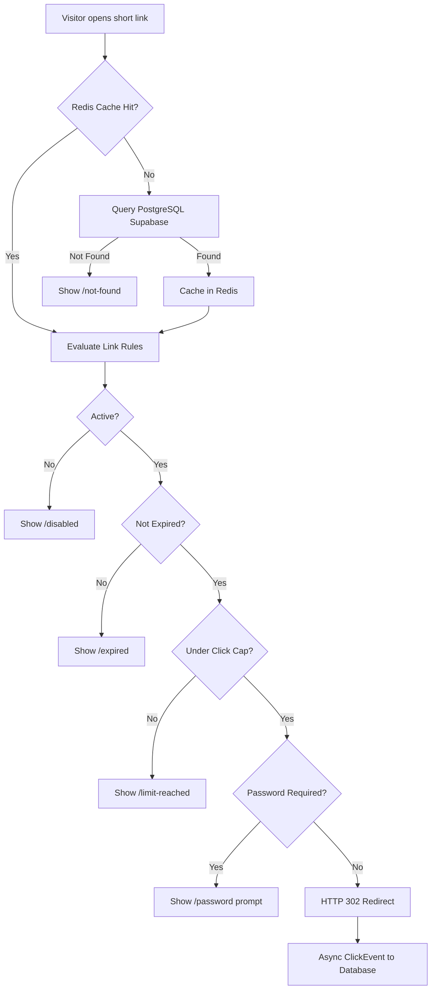
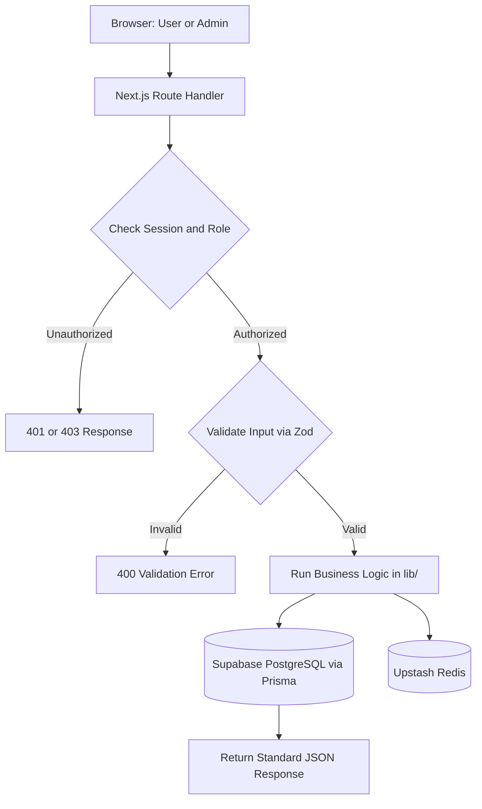

# LinkPulse Architecture

## 1. System Overview
LinkPulse is a governed URL shortener and analytics platform built with Next.js App Router, PostgreSQL on Supabase via Prisma, and Upstash Redis. Supabase is used ONLY as PostgreSQL through Prisma; LinkPulse does not use Supabase Auth, Storage, Realtime, or supabase-js. It manages the full link lifecycle: creation with pre-publish validation, rule-based redirection (status, expiry, click caps, passwords), asynchronous click logging, and analytics reporting.

## 2. Repository Structure and Ownership
```text
linkpulse/
|-- app/                    # Next.js App Router pages and route handlers
|   |-- [code]/             # Visitor redirect engine (Tejas)
|   |-- api/auth/           # Authentication endpoints (Milan)
|   |-- api/links/          # Link CRUD and validation check (Chirag)
|   |-- api/analytics/      # Timeseries, breakdowns, and metrics (Chirag)
|   |-- api/campaigns/      # Campaign management endpoints (Milan)
|   |-- api/tags/           # Tagging endpoints (Milan)
|   |-- api/import/         # CSV preview and batch commit (Milan)
|   |-- api/qr/             # QR code generation endpoint (Milan)
|   |-- api/admin/          # User lists and link disable controls (Milan)
|   |-- api/trace/          # Diagnostic rule evaluation endpoint (Tejas)
|   \-- (dashboard)/        # UI pages for links, analytics, and admin (Megha, Samriddhi)
|-- components/
|   |-- layout/             # Shell, navbar, and sidebar (Megha)
|   |-- wizard/             # Link creation two-step wizard (Megha)
|   |-- links/              # Links table, filters, and cards (Megha)
|   |-- charts/             # Recharts components for analytics (Samriddhi)
|   \-- analytics/          # Metric cards, breakdowns, alerts (Samriddhi)
|-- lib/
|   |-- db.ts               # Prisma client singleton (Tejas)
|   |-- api-response.ts     # Standard ok/fail JSON helpers (Tejas)
|   |-- cache.ts            # Upstash Redis cache read and invalidate (Tejas)
|   |-- click-logger.ts     # Async click worker with ua-parser (Tejas)
|   |-- bot.ts              # Bot detection using isbot (Tejas)
|   |-- shortcode.ts        # Unique code generation and alias rules (Chirag)
|   |-- validation.ts       # Zod schemas for request validation (Chirag)
|   |-- rules.ts            # Pure link rule evaluation function (Chirag)
|   |-- rate-limit.ts       # Upstash rate limiter per user (Chirag)
|   |-- analytics.ts        # Aggregation queries for metrics (Chirag)
|   |-- auth.ts             # Auth.js setup with bcrypt and Google (Milan)
|   |-- rbac.ts             # Role-based access control helpers (Milan)
|   |-- csv.ts              # CSV parser using Papaparse (Milan)
|   \-- qr.ts               # QR generator using qrcode (Milan)
\-- prisma/
    |-- schema.prisma       # Database schema (Tejas)
    \-- seed.ts             # Demo data seeder (Tejas)
```

## 3. Visitor Redirect Flow


## 4. Management Flow


## 5. Architectural Decisions
- Redis cache for redirects: Hot links resolve in single-digit milliseconds from Redis cache without hitting the database.
- Atomic click cap: Click cap checks use conditional SQL updates (WHERE clickCount < maxClicks) so concurrent requests never exceed limits.
- Async click logging: Click events are dispatched asynchronously after the 302 response begins, ensuring analytics logging never delays visitor redirection.
- Bot flag instead of deleting: Bots are flagged via isbot (isBot: true) and excluded from reports by default, retaining audit integrity.
- Hashed passwords: User account passwords and link passwords are encrypted with bcrypt before storage; plain text is never persisted.
- Role checks in every endpoint: Authorization helpers in lib/rbac.ts verify roles on the server in every route handler.
- Single codebase and deployment: Next.js App Router combines frontend, API route handlers, and server actions into one Vercel deployment.

## 6. Where Business Logic Lives
All core business logic resides exclusively in lib/. Route handlers in app/api/ act solely as transport adapters: they parse parameters, call lib/rbac.ts for permission checks, run lib/validation.ts, execute domain functions in lib/rules.ts or lib/analytics.ts, and serialize output via lib/api-response.ts.
