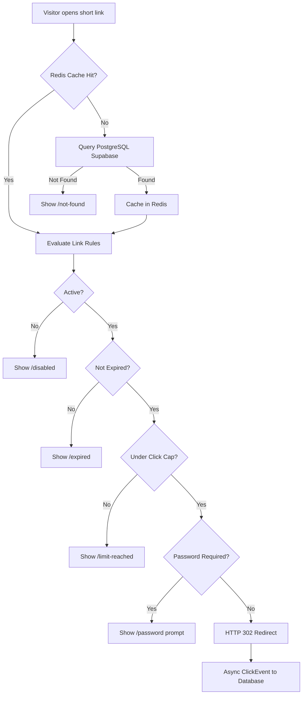
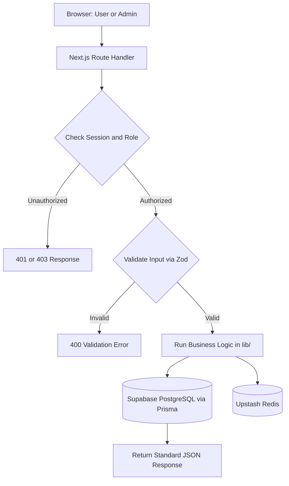

# LinkPulse Architecture

## 1. System Overview
LinkPulse is a governed URL shortener and analytics platform built with Next.js App Router, PostgreSQL on Supabase via Prisma, and Upstash Redis. Supabase is used ONLY as PostgreSQL through Prisma; LinkPulse does not use Supabase Auth, Storage, Realtime, or supabase-js. It manages the full link lifecycle: creation with pre-publish validation, rule-based redirection (status, expiry, click caps, passwords), asynchronous click logging, and analytics reporting.

## 2. Repository Structure and Ownership
```text
linkpulse/
|-- app/                    # Next.js App Router pages and route handlers
|   |-- (auth)/             # Login and register pages (Megha)
|   |-- (dashboard)/        # Dashboard, links, campaigns, import, trace, admin (Megha, Samriddhi)
|   |-- (public)/           # Status and unlock pages (Megha)
|   |-- [code]/             # Visitor redirect engine (Tejas)
|   |-- api/admin/          # Admin users, links, and blocklist endpoints (Milan)
|   |-- api/analytics/      # Summary, timeseries, breakdown, top-links, campaigns, alerts, insights (Chirag)
|   |-- api/auth/           # Auth.js and registration endpoints (Milan)
|   |-- api/campaigns/      # Campaign management endpoints (Milan)
|   |-- api/import/         # CSV preview and batch commit (Milan)
|   |-- api/links/          # Link CRUD and validation check (Chirag)
|   |-- api/qr/             # QR code generation endpoint (Milan)
|   |-- api/tags/           # Tagging endpoints (Milan)
|   |-- api/trace/          # Diagnostic rule evaluation endpoint (Tejas)
|   |-- api/unlock/         # Link password unlock verification (Tejas)
|   |-- globals.css         # Base theme and tokens (Megha)
|   |-- layout.tsx          # Root layout with Toaster and fonts (Megha)
|   \-- page.tsx            # Landing page placeholder (Megha)
|-- components/
|   |-- admin/              # Users table and blocklist manager (Samriddhi)
|   |-- analytics/          # Metric cards, period filter, bot toggle, insights, alerts (Samriddhi)
|   |-- campaigns/          # Campaign form and table (Samriddhi)
|   |-- charts/             # Recharts timeseries and breakdown charts (Samriddhi)
|   |-- csv/                # CSV import preview table (Samriddhi)
|   |-- layout/             # Navbar, sidebar, and page header (Megha)
|   |-- links/              # Links table, status badge, risk badge (Megha)
|   |-- qr/                 # QR dialog modal (Samriddhi)
|   |-- shared/             # Loading, error, and empty state components (Megha)
|   |-- ui/                 # shadcn/ui components
|   \-- wizard/             # Link creation step components and success screen (Megha)
|-- lib/
|   |-- analytics.ts        # Aggregation queries for metrics (Chirag)
|   |-- api-response.ts     # Standard ok/fail JSON helpers and ApiError (Tejas)
|   |-- api.ts              # Frontend API client (Megha)
|   |-- auth.ts             # Auth.js setup with bcrypt and Google (Milan)
|   |-- bot.ts              # Bot detection using isbot (Tejas)
|   |-- cache.ts            # Upstash Redis cache read and invalidate (Tejas)
|   |-- click-logger.ts     # Async click worker with ua-parser (Tejas)
|   |-- csv.ts              # CSV parser using Papaparse (Milan)
|   |-- db.ts               # Prisma client singleton (Tejas)
|   |-- env.ts              # Lazy environment variable validation with Zod (Tejas)
|   |-- qr.ts               # QR generator using qrcode (Milan)
|   |-- rate-limit.ts       # Upstash rate limiter per user (Chirag)
|   |-- rbac.ts             # Role-based access control helpers (Milan)
|   |-- risk.ts             # Safety risk scoring helper (Chirag)
|   |-- rules.ts            # Pure link rule evaluation function (Chirag)
|   |-- shortcode.ts        # Unique code generation and alias rules (Chirag)
|   |-- utils.ts            # Class name merge utility cn() (Megha)
|   \-- validation.ts       # Zod schemas for request validation (Chirag)
|-- mock/                   # JSON fixtures matching API specification
|-- prisma/
|   |-- schema.prisma       # Database schema (Tejas)
|   \-- seed.ts             # Demo data seeder stub (Tejas)
|-- proxy.ts                # Route protection proxy for auth and admin (Milan)
\-- types/
    |-- api.ts              # Shared request and response TypeScript interfaces
    \-- next-auth.d.ts      # NextAuth Session and User type extensions
```

## 3. Visitor Redirect Flow


## 4. Management Flow


## 5. Architectural Decisions
- Redis cache for redirects: Hot links resolve in single-digit milliseconds from Redis cache without hitting the database.
- Atomic click cap: Click cap checks use conditional SQL updates (WHERE clickCount < maxClicks) so concurrent requests never exceed limits.
- Async click logging: Click events are dispatched asynchronously after the 302 response begins, ensuring analytics logging never delays visitor redirection.
- Bot flag instead of deleting: Bots are flagged via isbot (isBot: true) and excluded from reports by default, retaining audit integrity.
- Hashed passwords: User account passwords and link passwords are encrypted with bcrypt before storage; plain text is never persisted.
- Role checks in every endpoint: Authorization helpers in lib/rbac.ts verify roles on the server in every route handler.
- Single codebase and deployment: Next.js App Router combines frontend, API route handlers, and server actions into one Vercel deployment.
- Server-only modules: Backend modules in lib/ import server-only to guarantee database access, secrets, and core logic never leak into client bundles.
- Mock data switch: Setting NEXT_PUBLIC_USE_MOCKS to true enables the frontend to read JSON fixtures from mock/ without live APIs or databases.

## 6. Where Business Logic Lives
All core business logic resides exclusively in lib/. Route handlers in app/api/ act solely as transport adapters: they parse parameters, call lib/rbac.ts for permission checks, run lib/validation.ts, execute domain functions in lib/rules.ts or lib/analytics.ts, and serialize output via lib/api-response.ts.
