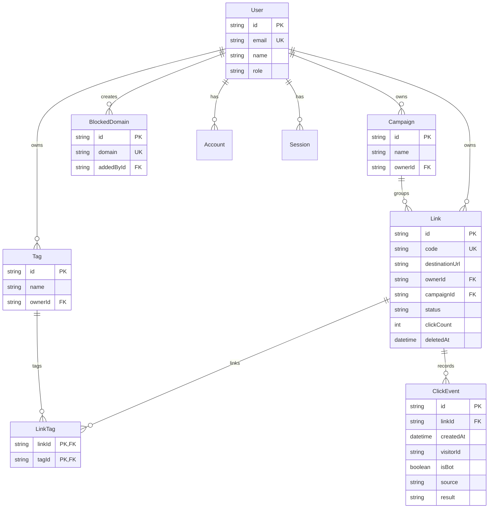

# LinkPulse Database Documentation

## 1. Overview

LinkPulse uses PostgreSQL hosted on Supabase, managed with Prisma ORM. The central entity is the Link. Users own links, campaigns, and tags. Links can belong to an optional campaign and carry multiple tags via LinkTag. Every visitor interaction produces an asynchronous ClickEvent row. Admins manage global rules like BlockedDomain.

Auth.js manages authentication with JWT sessions. Credentials (email and bcrypt password) and Google OAuth are supported. Session and VerificationToken tables are available for Auth.js adapter compatibility.

## 2. Entity Relationship Diagram

## 3. Enums

### Role
Defines authorization privileges across the platform.
- USER: Standard user who creates and manages own links, campaigns, tags, and QR codes.
- ADMIN: Platform administrator with access to all data, disable controls, and domain blocklist.

### LinkStatus
Controls redirect engine behavior.
- ACTIVE: Link is active and can redirect if rules pass.
- DISABLED: Link is turned off manually by the owner. Redirect stops immediately.
- ADMIN_DISABLED: Link is disabled by an admin for abuse or moderation. Only an admin can re-enable it.

Note: Expired state is not stored in LinkStatus. Expiration is derived at runtime by checking if expiresAt is in the past.

### ClickSource
Indicates how the link was opened.
- LINK: Standard web link click.
- QR: Scanned from a LinkPulse generated QR code.

### ClickResult
Records the outcome of the visitor request.
- SUCCESS: Passed all checks and redirected (302).
- DISABLED: Rejected because link status is DISABLED or ADMIN_DISABLED.
- EXPIRED: Rejected because expiresAt is in the past.
- LIMIT_REACHED: Rejected because clickCount reached maxClicks.
- PASSWORD_FAILED: Rejected because entered password was missing or invalid.

## 4. Models and Tables

### User
Represents a registered user or administrator.

| Field | Type | Required | Notes |
|---|---|---|---|
| id | String (cuid) | Yes | Primary key |
| name | String | No | Display name |
| email | String | Yes | Unique login email |
| emailVerified | DateTime | No | Timestamp of email verification |
| passwordHash | String | No | Bcrypt hash for credentials login; null for OAuth users |
| image | String | No | Profile avatar URL |
| role | Role | Yes | Defaults to USER |
| createdAt | DateTime | Yes | Account creation timestamp (UTC) |
| updatedAt | DateTime | Yes | Last update timestamp (UTC) |

### Link
The central record representing a shortened URL and its redirect rules.

| Field | Type | Required | Notes |
|---|---|---|---|
| id | String (cuid) | Yes | Primary key |
| code | String | Yes | Unique public alias or random short code. Stored in lowercase (normalized on save); aliases are matched case-insensitively |
| destinationUrl | String | Yes | Target destination URL |
| ownerId | String | Yes | Foreign key to User. Cascade on delete |
| campaignId | String | No | Foreign key to Campaign. Set null on delete |
| status | LinkStatus | Yes | Defaults to ACTIVE |
| expiresAt | DateTime | No | Optional expiry date in UTC |
| maxClicks | Int | No | Optional maximum number of successful clicks |
| clickCount | Int | Yes | Counter for atomic click cap check. Defaults to 0 |
| passwordHash | String | No | Optional bcrypt hash for password-protected links |
| mobileUrl | String | No | Optional destination override for mobile devices |
| deletedAt | DateTime | No | Timestamp for soft-deletion; null if active |
| createdAt | DateTime | Yes | Creation timestamp (UTC) |
| updatedAt | DateTime | Yes | Last update timestamp (UTC) |

### Campaign
Groups multiple links together for organized analytics.

| Field | Type | Required | Notes |
|---|---|---|---|
| id | String (cuid) | Yes | Primary key |
| name | String | Yes | Campaign name |
| description | String | No | Optional campaign notes |
| ownerId | String | Yes | Foreign key to User. Cascade on delete |
| createdAt | DateTime | Yes | Creation timestamp (UTC) |
| updatedAt | DateTime | Yes | Last update timestamp (UTC) |

### Tag
Labels for categorizing links, scoped per user owner.

| Field | Type | Required | Notes |
|---|---|---|---|
| id | String (cuid) | Yes | Primary key |
| name | String | Yes | Tag label, unique per owner |
| ownerId | String | Yes | Foreign key to User. Cascade on delete |
| createdAt | DateTime | Yes | Creation timestamp (UTC) |

Unique constraint: (ownerId, name).

### LinkTag
Explicit join table creating many-to-many relationship between Link and Tag.

| Field | Type | Required | Notes |
|---|---|---|---|
| linkId | String | Yes | Foreign key to Link. Cascade on delete |
| tagId | String | Yes | Foreign key to Tag. Cascade on delete |

Composite primary key: (linkId, tagId).

### ClickEvent
Captures every visit asynchronously.

| Field | Type | Required | Notes |
|---|---|---|---|
| id | String (cuid) | Yes | Primary key |
| linkId | String | Yes | Foreign key to Link. Cascade on delete |
| createdAt | DateTime | Yes | Event timestamp (UTC) |
| referrer | String | No | HTTP Referer header or direct |
| deviceType | String | No | mobile, desktop, or tablet from user agent |
| browser | String | No | Chrome, Safari, Firefox, Edge, etc. |
| os | String | No | Windows, macOS, Android, iOS, Linux |
| country | String | No | Geographic location code if available |
| isBot | Boolean | Yes | Flagged by isbot parser. Defaults to false |
| visitorId | String | Yes | Anonymized hashed visitor identifier |
| source | ClickSource | Yes | LINK or QR. Defaults to LINK |
| result | ClickResult | Yes | Outcome code. Defaults to SUCCESS |

### BlockedDomain
Global blocklist of forbidden domains maintained by administrators.

| Field | Type | Required | Notes |
|---|---|---|---|
| id | String (cuid) | Yes | Primary key |
| domain | String | Yes | Unique hostname (for example: malicious-site.com) |
| addedById | String | No | Foreign key to User (Admin). Set null on delete |
| createdAt | DateTime | Yes | Creation timestamp (UTC) |

### Auth.js Tables (Account, Session, VerificationToken)
These models follow the standard Auth.js Prisma adapter format:
- Account: Stores OAuth accounts (such as Google OAuth) linked to a User.
- Session: Used if database session strategy is enabled. LinkPulse defaults to JWT sessions.
- VerificationToken: Used for magic links or email verification flows.

## 5. Indexes and Rationale

| Model | Index Fields | Purpose |
|---|---|---|
| Link | (ownerId, deletedAt, createdAt) | Fast retrieval of active, non-deleted user links ordered by recency |
| Link | campaignId | Quick lookup of all links within a campaign |
| ClickEvent | (linkId, createdAt) | Time-range filtering and analytics charts per link |
| ClickEvent | (linkId, isBot) | Fast filtering when bot toggle is enabled or disabled |
| ClickEvent | createdAt | Platform-wide analytics queries for admin dashboard |
| Tag | (ownerId, name) (unique) | Enforces unique tag names per owner while allowing identical names across different users |
| LinkTag | tagId | Reverse lookup of all links carrying a specific tag |
| BlockedDomain | domain (unique) | Immediate check during link creation wizard validation |
| User | email (unique) | Fast lookup during credentials and OAuth authentication |
| User | role | Filter users by role in admin queries |

Note on index cleanup: Redundant single-column indexes on Link(code), BlockedDomain(domain), and LinkTag(linkId) were removed because they are already covered by @unique or composite primary keys.

## 6. Click History Protection and Cascade Rules

- Normal lifecycle: Expired and disabled links are never removed by background cleanup jobs. Expired links remain in the database with their past expiresAt timestamp. Disabled links remain with status = DISABLED or ADMIN_DISABLED. All historical ClickEvent records remain intact and visible in analytics reports.
- Soft deletion: When an owner or admin deletes a link, deletedAt is set to the current timestamp. The record and its click history are kept in PostgreSQL. The code remains reserved. Queries for active links filter out records where deletedAt is not null.
- Explicit deletion: If a link is permanently removed from the database, cascading foreign keys remove the corresponding LinkTag and ClickEvent records to maintain database referential integrity.
- Campaign deletion: When a campaign is deleted, related links have their campaignId set to NULL (onDelete: SetNull), keeping the links and clicks active.

## 7. Rules for Changing the Schema

1. Only Tejas (Team Lead) runs `npx prisma migrate dev` and commits migrations to the repository.
2. Teammates never run migration generation commands. Everyone else runs `npx prisma generate` after pulling `dev` to update their local client.
3. Teammates run `npx prisma migrate deploy` only if explicitly instructed by Tejas when updating a local testing database.

## 8. Rules Enforced in Application Code, Not by the Schema

1. An owner cannot re-enable an ADMIN_DISABLED link. Only an admin can. The owner may only switch their own link between ACTIVE and DISABLED. Admin disable sets ADMIN_DISABLED. Admin enable sets ACTIVE.
2. Soft delete: DELETE on a link sets deletedAt. Every list, read, update and redirect query must ignore links where deletedAt is set. The redirect for such a code returns NOT_FOUND. Click history is kept. The short code stays reserved because code is still unique.
